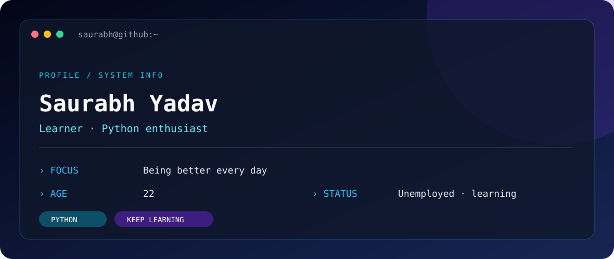

  

<picture>
  <source media="(prefers-color-scheme: dark)" srcset="./dark.svg">
  <source media="(prefers-color-scheme: light)" srcset="./light.svg">
  
</picture>

## About me

Hi, I’m Saurabh Yadav. I’m 22 and focused on learning, building, and being better every day. I enjoy exploring Python through practical projects and turning ideas into working code.

**Age:** 22  
**Status:** Unemployed · actively learning and building  
**Focus:** Being better every day  
**Email:** [yadavsaurabh0900@gmail.com](mailto:yadavsaurabh0900@gmail.com)

## Featured projects

- [cattle_breed_identification](https://github.com/yadavsaurabh0900-byte/cattle_breed_identification) — Image-based cattle recognition in Python.
- [timepass](https://github.com/yadavsaurabh0900-byte/timepass) — A personal experimental project.

## GitHub activity

  
  

## Connect

- GitHub: [@yadavsaurabh0900-byte](https://github.com/yadavsaurabh0900-byte)
